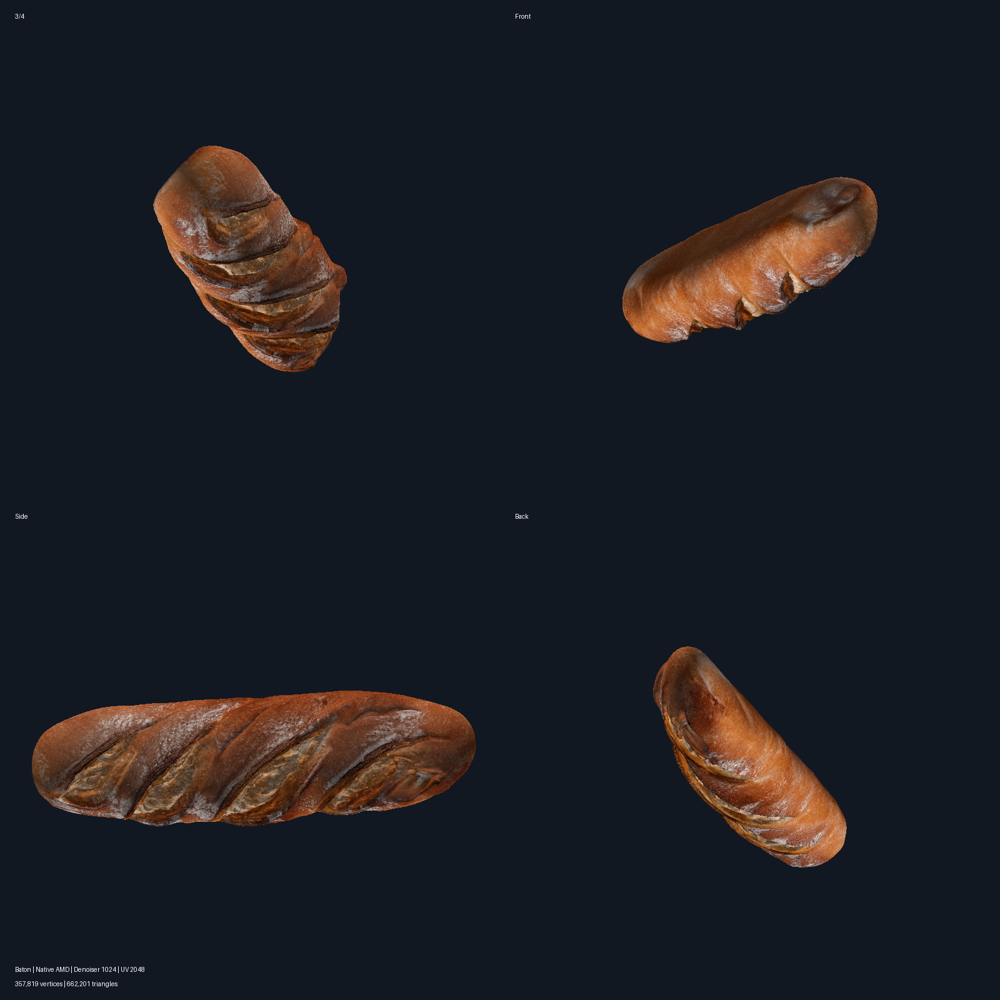

# Pixal3D / TRELLIS.2 — Native AMD ROCm for Windows

Independent native Windows ROCm/HIP installation and verification tools for Pixal3D / TRELLIS.2, with prebuilt CPython 3.12 HIP extension wheels and a reviewed generation example.

**Verified configuration:** AMD Radeon RX 9070 XT (`gfx1201`), Windows, ROCm 7.2.1 and PyTorch 2.9.1+rocm7.2.1. Other GPUs, neural networks and generation modes are not claimed as verified.

[Russian quick start](README.ru.md) · [RX 9070 XT evidence](docs/RX9070XT.md) · [Third-party notices](THIRD_PARTY_NOTICES.md)



## What is included

- Isolated portable CPython 3.12.10 installation; system Python is not modified.
- Pinned official ROCm/PyTorch downloads with byte-size and SHA-256 verification.
- Three bundled HIP wheels: CuMesh, FlexGEMM and O-Voxel.
- Fail-closed hardware, sparse-SDPA, NAF, FlexGEMM, O-Voxel and CuMesh probes.
- Separate base and extension readiness reports; no production generation gate is written.
- A reviewed Standard 1024 baton GLB with an embedded 2048 × 2048 base-color atlas.

Full ComfyUI/TRELLIS.2 sources and model weights are **not included**. Installation and successful probes establish runtime/extension readiness only; they do not install model weights or unlock generation modes.

## Hunyuan3D-2 — separate package

The [`hunyuan3d-amd/`](hunyuan3d-amd/) directory contains a focused ComfyUI + Hunyuan3D-2 + u2net installer for native AMD ROCm on Windows. It does not install Pixal3D or WSL. Model weights are downloaded during installation rather than stored in Git.

This is a separate package and is **not covered by the hardware-verified Pixal3D example above**. See its [Russian README](hunyuan3d-amd/README.ru.md) and [source notes](hunyuan3d-amd/SOURCE.md).

## Requirements

- Windows 10/11 x64.
- AMD Radeon RX 9070 XT for the reviewed profile.
- An existing, working AMD graphics driver. This toolkit never installs, replaces or rolls back drivers and never requests a reboot.
- Enough disk space for the isolated runtime and official packages. Large downloads are not included in Git.

## Install and verify

Run from the repository root. The destination must be a new, native Windows path outside an existing NVIDIA or WSL runtime.

### 1. Dry run — no downloads or changes

```powershell
powershell -NoProfile -ExecutionPolicy Bypass -File installer/amd/Pixal3DNative.ps1 -RuntimeRoot C:\AMD-AI\Pixal3D-ROCm -DryRun
```

### 2. Install and run all probes

```powershell
powershell -NoProfile -ExecutionPolicy Bypass -File installer/amd/Pixal3DNative.ps1 -RuntimeRoot C:\AMD-AI\Pixal3D-ROCm
```

The installer downloads missing official packages from `repo.radeon.com`, verifies every package, installs the bundled HIP wheels offline with `--no-index --no-deps`, and stops on any failed mandatory check.

### 3. Repeat the base hardware probe

```powershell
powershell -NoProfile -ExecutionPolicy Bypass -File installer/amd/Pixal3DNative.ps1 -RuntimeRoot C:\AMD-AI\Pixal3D-ROCm -ProbeOnly -ForceProbe
```

`-ProbeOnly` runs the hardware probe without installing packages. `-ForceProbe` forces base reinstallation/probing during a full run. `-SkipModels` is accepted for workflow compatibility; this standalone toolkit never downloads model weights.

Reports are written under `data/runtime/diagnostics/native-amd/`. Base and extension readiness markers are written separately inside the selected runtime. A failed mandatory check removes or prevents the corresponding marker.

## Reviewed example

The example used Standard 1024 geometry, the 1024 denoiser and an exact 2048 × 2048 base-color atlas:

- 499 seconds measured on the reviewed configuration;
- 357,819 vertices and 662,201 triangles;
- 22,138,764-byte GLB;
- no fallback events.

[Open the GLB](examples/baton-uv2048/baton-uv2048.glb) · [Atlas preview](examples/baton-uv2048/atlas-preview.png) · [Measured result](examples/baton-uv2048/result.json)

The preview and atlas are for inspection; the GLB contains the actual embedded 2048 × 2048 PNG texture.

## Repository checks (no GPU)

```powershell
powershell -NoProfile -ExecutionPolicy Bypass -File tests/Smoke.ps1
python -m unittest discover -s tests -p "test_*.py" -v
```

These checks validate manifests, the three HIP wheel hashes, fail-closed contracts, example geometry/atlas dimensions, required notices and public-file hygiene. They do not download ROCm/PyTorch or run generation.

## Limitations and licensing

Only the documented RX 9070 XT profile has hardware evidence. NATTEN and nvdiffrast are optional and reported as unsupported in the reviewed environment. This is not a universal AMD backend and does not prove absence of driver stalls or micro-freezes.

The owner's original work is MIT-licensed. Third-party licenses still apply. In particular, cubvh's NVIDIA Source Code License section 3.3 restricts its covered work and derivatives to non-commercial research or evaluation. Read [THIRD_PARTY_NOTICES.md](THIRD_PARTY_NOTICES.md) and the complete texts in `licenses/` before use or redistribution.
