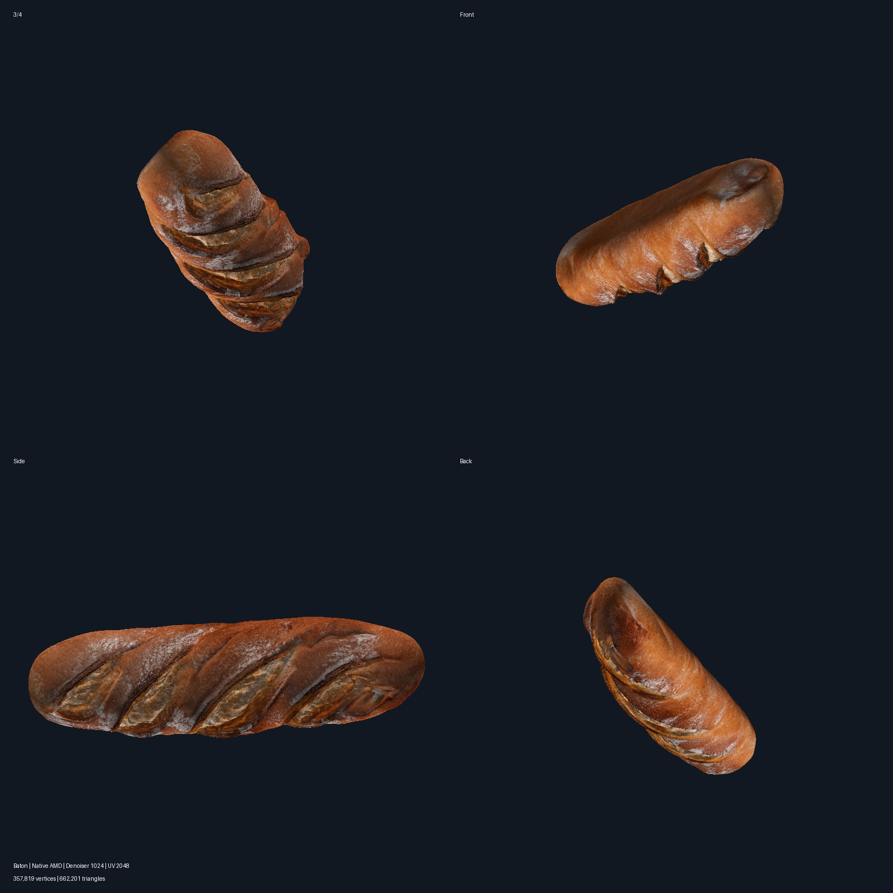

# Pixal3D / TRELLIS.2 — нативный AMD ROCm для Windows

[](https://github.com/tsubasaprogame/Pixal3D-TRELLIS.2-AMD-ROCm-WINDOWS/actions/workflows/smoke.yml?query=branch%3Amain)

Независимый комплект установки и проверки Pixal3D / TRELLIS.2 на AMD ROCm/HIP без WSL и без изменения системного Python.

Проверенная конфигурация только одна: **Windows, AMD Radeon RX 9070 XT (`gfx1201`), ROCm 7.2.1, PyTorch 2.9.1+rocm7.2.1**. Поддержка других видеокарт и нейросетей не заявляется.

[Основная документация](README.md) · [Результаты проверки](docs/RX9070XT.md)



## Быстрый старт

Команды выполняются из корня репозитория. Укажите новый отдельный каталог, не совпадающий с существующим NVIDIA или WSL runtime.

Сухой запуск без скачиваний и изменений:

```powershell
powershell -NoProfile -ExecutionPolicy Bypass -File installer/amd/Pixal3DNative.ps1 -RuntimeRoot C:\AMD-AI\Pixal3D-ROCm -DryRun
```

Установка и полная проверка:

```powershell
powershell -NoProfile -ExecutionPolicy Bypass -File installer/amd/Pixal3DNative.ps1 -RuntimeRoot C:\AMD-AI\Pixal3D-ROCm
```

Повторная базовая проверка GPU:

```powershell
powershell -NoProfile -ExecutionPolicy Bypass -File installer/amd/Pixal3DNative.ps1 -RuntimeRoot C:\AMD-AI\Pixal3D-ROCm -ProbeOnly -ForceProbe
```

Официальные ROCm/PyTorch скачиваются с закреплённых адресов `repo.radeon.com`; размер и SHA-256 проверяются обязательно. Три HIP-колеса CuMesh, FlexGEMM и O-Voxel уже находятся в репозитории и устанавливаются офлайн.

Драйверы не устанавливаются и не заменяются. Перезагрузка не требуется. Полные исходники ComfyUI/TRELLIS.2 и веса моделей не входят в комплект: успешная установка означает готовность среды и расширений, но не включает генерацию автоматически.

## Hunyuan3D-2 — отдельный пакет

В каталоге [`hunyuan3d-amd/`](hunyuan3d-amd/) находится отдельный установщик **ComfyUI + Hunyuan3D-2 + u2net** для нативного AMD ROCm в Windows. Он не устанавливает Pixal3D и не использует WSL. Веса моделей скачиваются при установке и не хранятся в Git.

Это самостоятельный пакет. Автор сообщает об успешном запуске и работе Hunyuan3D на AMD, но точные автоматические аппаратные тесты и замеры не проводились. Подробности — в [README пакета](hunyuan3d-amd/README.ru.md) и [описании источников](hunyuan3d-amd/SOURCE.md).

## Пример

[GLB-батон](examples/baton-uv2048/baton-uv2048.glb) · [Превью атласа](examples/baton-uv2048/atlas-preview.png) · [Измеренный результат](examples/baton-uv2048/result.json)

- Геометрия Standard 1024, denoiser 1024.
- Встроенная base-color текстура ровно 2048 × 2048.
- 357 819 вершин, 662 201 треугольник.
- 499 секунд на проверенной конфигурации; событий fallback нет.

## Проверка репозитория без GPU

```powershell
python -m pip install --disable-pip-version-check numpy==2.5.2
powershell -NoProfile -ExecutionPolicy Bypass -File tests/Smoke.ps1
python -m unittest -v tests/test_bvh_golden.py tests/test_bvh_reference.py tests/test_cubql_bvh.py tests/test_native_tools.py tests/test_publication.py
```

Полный запуск всех `test_*.py` дополнительно требует AMD/PyTorch-окружение и RX 9070 XT, поэтому он отделён от no-GPU CI.

## Лицензии

Оригинальные файлы владельца распространяются по MIT, но сторонние условия сохраняются. Новый BVH-backend CuMesh использует cuBQL по лицензии Apache-2.0; точная ревизия записана в `installer/amd/cubql-source.json`. Полные тексты находятся в `licenses/`, сводка — в [THIRD_PARTY_NOTICES.md](THIRD_PARTY_NOTICES.md).
